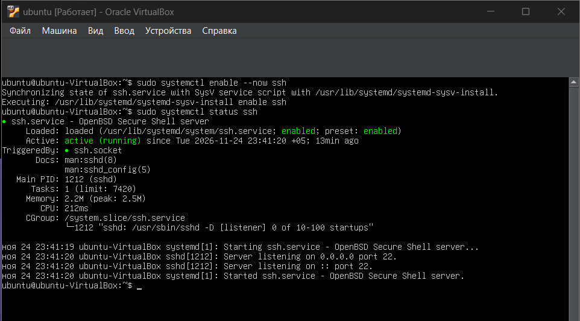
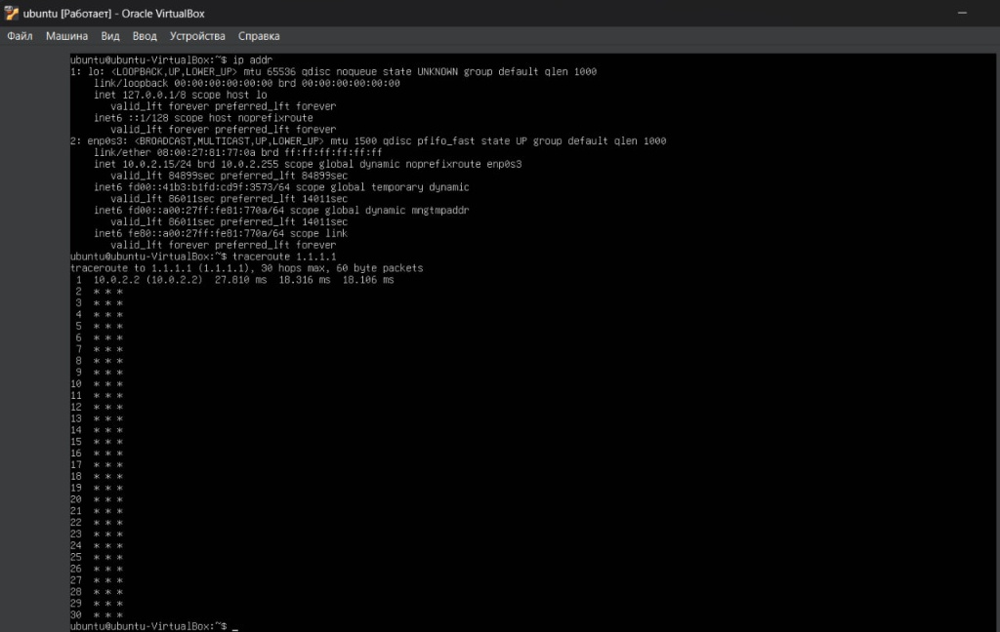
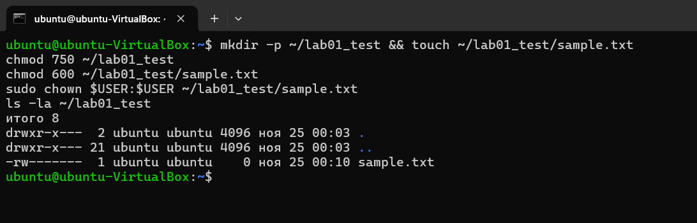
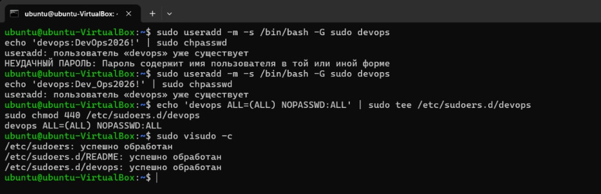
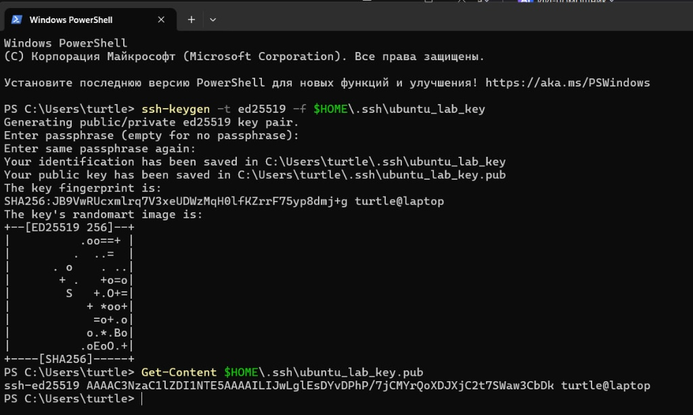
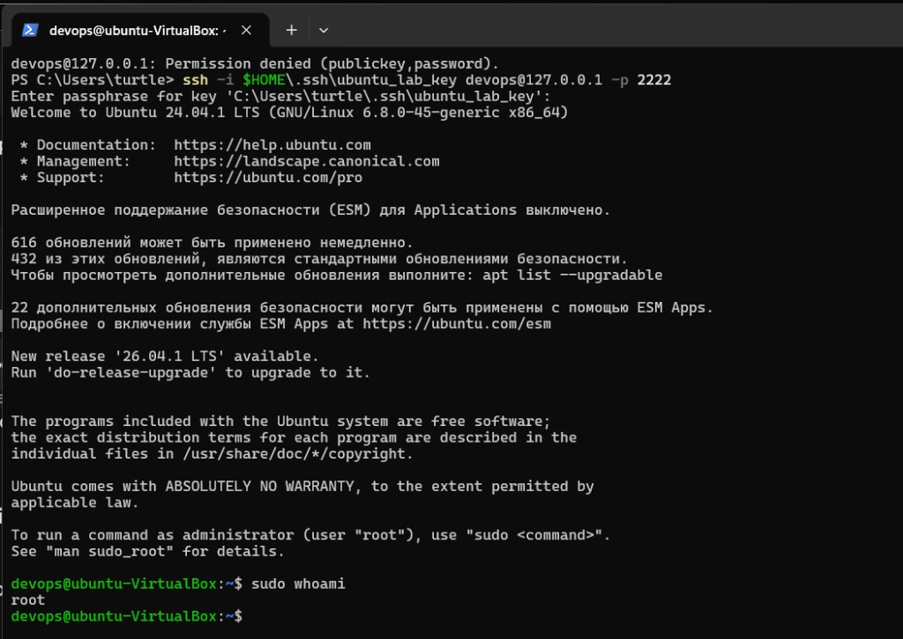
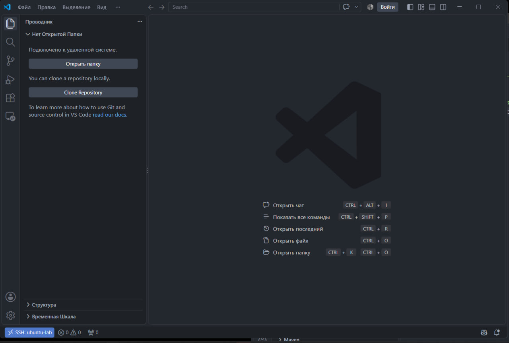

# П01. Базовое администрирование Linux. Управление пользователями. Вход SSH по ключу

## Описание работы
Практическая работа №1 по курсу DevOps:
1. Развертывание виртуальной машины с **Ubuntu 24.04 LTS** в **Oracle VirtualBox** и настройка проброса портов в режиме **NAT** (`127.0.0.1:2222 -> 10.0.2.15:22`).
2. Установка, запуск и добавление в автозагрузку службы **OpenSSH Server**.
3. Установка базовых пакетов (`python3`, `git`, `traceroute`) и проведение диагностики ОС, дисковой подсистемы, прав доступа и сети.
4. Создание пользователя `devops` с домашним каталогом и настройка прав `sudo` без запроса пароля.
5. Генерация пары SSH-ключей `ed25519`, настройка аутентификации по ключу и подключение к виртуальной машине из терминала Windows и **Visual Studio Code (Remote - SSH)**.

## Структура репозитория
* `README.md` — описание выполненной работы и отчёт со скриншотами.
* `scripts/setup_and_diagnostics.sh` — скрипт установки пакетов, диагностики системы и настройки пользователя.
* `configs/ssh_config` — клиентская конфигурация SSH для подключения к хосту `ubuntu-lab`.
* `configs/sudoers_devops` — правило `sudoers` для предоставления пользователю `devops` прав `NOPASSWD:ALL`.
* `screenshots/` — скриншоты, подтверждающие успешное выполнение всех этапов лабораторной работы.

---

## Ход выполнения работы и результаты

### 1. Установка и запуск SSH-сервера
Установлен пакет `openssh-server`, служба `ssh` добавлена в автозагрузку и запущена (`active (running)`), сервер прослушивает порт `22`:

```bash
sudo apt update && sudo apt install -y openssh-server
sudo systemctl enable --now ssh
sudo systemctl status ssh
```



---

### 2. Диагностика сети, ОС и прав доступа
Выполнена проверка сетевых интерфейсов (`ip addr` — интерфейс `enp0s3` получил адрес `10.0.2.15/24` в сети NAT VirtualBox) и трассировка маршрута (`traceroute 1.1.1.1`):

```bash
ip addr
traceroute 1.1.1.1
```



Проведена работа с правами доступа и владельцами файлов с помощью утилит `chmod` и `chown`:

```bash
mkdir -p ~/lab01_test && touch ~/lab01_test/sample.txt
chmod 750 ~/lab01_test
chmod 600 ~/lab01_test/sample.txt
sudo chown $USER:$USER ~/lab01_test/sample.txt
ls -la ~/lab01_test
```



---

### 3. Создание пользователя и настройка sudo без пароля
Создан пользователь `devops` с домашним каталогом `/home/devops`, включённый в группу `sudo`. В директории `/etc/sudoers.d/devops` добавлено правило `devops ALL=(ALL) NOPASSWD:ALL` и выполнена проверка синтаксиса через `sudo visudo -c`:

```bash
sudo useradd -m -s /bin/bash -G sudo devops
echo 'devops ALL=(ALL) NOPASSWD:ALL' | sudo tee /etc/sudoers.d/devops
sudo chmod 440 /etc/sudoers.d/devops
sudo visudo -c
```



---

### 4. Генерация SSH-ключа и подключение к виртуальной машине
На хостовой машине (Windows) сгенерирована пара ключей `ed25519` (`ubuntu_lab_key` и `ubuntu_lab_key.pub`):

```powershell
ssh-keygen -t ed25519 -f $HOME\.ssh\ubuntu_lab_key
Get-Content $HOME\.ssh\ubuntu_lab_key.pub
```



После добавления публичного ключа в `/home/devops/.ssh/authorized_keys` выполнено успешное подключение по SSH-ключу через проброшенный порт `2222` и проверено выполнение `sudo whoami` без запроса пароля:

```powershell
ssh -i $HOME\.ssh\ubuntu_lab_key devops@127.0.0.1 -p 2222
```



---

### 5. Подключение к виртуальной машине через VS Code Remote - SSH
В Visual Studio Code установлено расширение **Remote - SSH**, в файл `~/.ssh/config` добавлен профиль `ubuntu-lab` (см. `configs/ssh_config`) и выполнено подключение к удалённой виртуальной машине:


